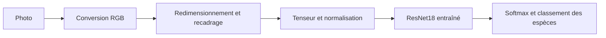
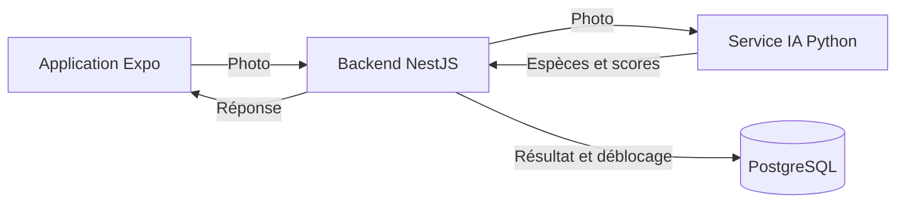

# Reconnaissance d'espèces animales à partir de photos

État documenté le **22 octobre 2026**.

Ce document présente le travail réalisé dans `ai-recognition` : constitution du
dataset, préparation des images, entraînement, évaluation et prédiction locale.
Il distingue les éléments implémentés des étapes restantes pour intégrer la
reconnaissance à l'application.

Les effectifs et les résultats ci-dessous correspondent aux données et au modèle
présents localement à cette date. Le dataset, l'environnement Python et les
checkpoints sont exclus de Git par [`.gitignore`](.gitignore).

## 1. Objectif et périmètre

Le module doit identifier l'espèce animale présente sur une photographie parmi
les **cinq espèces prises en charge**. Il retourne un classement des espèces
candidates, ordonnées par score décroissant : les trois premières par défaut.
Ce classement permet au backend de connaître l'espèce proposée par le modèle,
placée en première position, ainsi que les autres espèces candidates et leurs
scores.

Le module Python doit être hébergé dans un **conteneur Docker sur un serveur**.
Le backend lui transmettra les photographies à analyser et recevra les résultats
de reconnaissance pour les exploiter dans l'application. La création de l'API et
le déploiement du conteneur font partie des étapes d'intégration restantes.

### Classification de l'image et localisation de l'animal

Le modèle actuel réalise une **classification d'image** : à partir de la photo
préparée, il calcule un score pour chacune des cinq espèces. Le résultat concerne
l'image dans son ensemble, sans indiquer la position de l'animal.

La **localisation** consiste à déterminer où se trouve l'animal dans l'image,
par exemple en retournant les coordonnées d'un rectangle qui l'encadre.

| Tâche | Exemple pour une photo de lion |
| --- | --- |
| Classification | Retourner « lion » comme première espèce candidate, avec son score |
| Localisation | Retourner les coordonnées d'un rectangle autour du lion |

Le dataset actuel fournit une étiquette d'espèce par image, à travers son dossier
de classement. Il ne fournit pas de rectangles annotant la position des animaux,
et le modèle ne produit pas de coordonnées.

Le top des espèces représente donc plusieurs hypothèses pour une même photo.
Un top 3 ne signifie pas que trois animaux ont été détectés. Si plusieurs animaux
sont présents, le modèle ne les identifie pas séparément.

## 2. Organisation du module

```text
ai-recognition/
├── download_dataset.py          # Collecte des photos et de leurs métadonnées
├── split_dataset.py             # Séparation des données par espèce et par groupe
├── README_DATASET.md            # Documentation détaillée de ces deux scripts
├── data/                        # Données locales, non versionnées
│   ├── raw/                     # Photos sources et manifest.csv
│   ├── splits/                  # train/, val/, test/ et rapports de séparation
│   ├── external_tests/          # Photos supplémentaires pour essais manuels
│   └── processed/               # Dossier actuellement vide
├── checkpoints/                 # Modèles sauvegardés, non versionnés
│   └── best_model.pth
└── src/
    ├── models/
    │   ├── resnet.py            # Création de ResNet18 pour les classes du dataset
    │   └── cnn.py               # Fichier actuellement vide
    ├── preprocessing/
    │   └── filters.py           # Fichier actuellement vide
    ├── training/
    │   ├── dataset.py           # ImageFolder, transformations et DataLoader
    │   └── train.py             # Entraînement et sélection du meilleur modèle
    ├── evaluation/
    │   └── evaluate.py          # Mesures sur le jeu de test
    └── inference/
        └── predict.py           # Reconnaissance d'une nouvelle photographie
```

Les transformations sont appliquées en mémoire lors du chargement des images.
Le pipeline actuel n'utilise pas `data/processed/`, `cnn.py` ou `filters.py`.
Les dossiers `experiments/` et `notebooks/` sont également présents, mais vides.

## 3. Constitution et séparation du dataset

### 3.1. Collecte et provenance

Le script [`download_dataset.py`](download_dataset.py) recherche les photos via
l'API iNaturalist. La configuration par défaut vise **200 images par espèce**,
avec une seule photo acceptée par observation.

Les principaux contrôles implémentés sont les suivants :

- recherche du taxon à partir du nom scientifique ;
- sélection d'observations sauvages (`captive=false`) et de qualité `research` ;
- vérification de la licence de chaque photo ;
- vérification du fichier avec Pillow et d'un côté minimum de 256 pixels ;
- déduplication par identifiant d'observation, identifiant de photo et SHA-256 ;
- reprise à partir du manifeste existant et gestion des erreurs réseau transitoires.

Le fichier `data/raw/manifest.csv` conserve notamment l'espèce demandée, le taxon
observé, les identifiants et URL sources, l'attribution, la licence, les dimensions,
le chemin local et l'empreinte SHA-256 de chaque image.

Le manifeste local contient **913 lignes**, avec 913 identifiants d'observation,
913 identifiants de photo et 913 empreintes distincts. Toutes les lignes indiquent
`research` et `captive=False`. Les licences enregistrées sont `cc0` (268 photos),
`cc-by` (534) et `cc-by-sa` (111). Le manifeste accompagne les photos pour conserver
leur provenance et les informations nécessaires à leur réutilisation.

### 3.2. Effectifs disponibles

| Espèce | Classe utilisée par le code | Total | Entraînement | Validation | Test |
| --- | --- | ---: | ---: | ---: | ---: |
| Zèbre des plaines — *Equus quagga* | `equus_quagga` | 200 | 140 | 30 | 30 |
| Girafe — *Giraffa camelopardalis* | `giraffa_camelopardalis` | 113 | 79 | 17 | 17 |
| Éléphant de savane d'Afrique — *Loxodonta africana* | `loxodonta_africana` | 200 | 140 | 30 | 30 |
| Lion — *Panthera leo* | `panthera_leo` | 200 | 140 | 30 | 30 |
| Tigre — *Panthera tigris* | `panthera_tigris` | 200 | 140 | 30 | 30 |
| **Total** | **5 classes** | **913** | **639** | **137** | **137** |

Ces effectifs proviennent de `data/splits/summary.json` et ont été comparés aux
fichiers présents. La cible de 200 images n'est pas atteinte pour la girafe ; la
cause de cet écart n'est pas enregistrée dans le rapport de séparation.

### 3.3. Rôle des trois ensembles

Le script [`split_dataset.py`](split_dataset.py) utilise les proportions cibles
**70 % / 15 % / 15 %** et la seed **42**.

- **Entraînement (`train`)** : images utilisées pour ajuster les poids de la couche finale.
- **Validation (`val`)** : images utilisées après chaque époque pour sélectionner le meilleur checkpoint.
- **Test (`test`)** : images utilisées pour mesurer les performances du checkpoint sélectionné, sans ajuster ses poids.

Les photos d'une même observation et les fichiers ayant les mêmes octets sont
regroupés avant l'affectation. Un groupe reste dans un seul ensemble. Les images
sont copiées sans redimensionnement et les originaux restent dans `data/raw/`.

Deux rapports sont produits : `summary.json`, pour les effectifs et paramètres,
et `split_manifest.csv`, pour les affectations et la provenance de chaque image.
La vérification des manifestes locaux n'a trouvé aucun identifiant d'observation
ni SHA-256 partagé entre deux ensembles.

Ce contrôle ne détecte pas les images visuellement proches mais réencodées ou
recadrées. Il ne garantit pas non plus que des photos d'un même individu ou d'un
même observateur se trouvent toujours dans le même ensemble.

Les options de collecte, de reprise et de séparation sont détaillées dans
[`README_DATASET.md`](README_DATASET.md).

## 4. Préparation des images

Le fichier [`src/training/dataset.py`](src/training/dataset.py) utilise
`torchvision.datasets.ImageFolder`. Chaque sous-dossier d'espèce définit une
classe. Le code vérifie que les correspondances entre classes et indices sont
identiques pour l'entraînement, la validation et le test.

| Étape | Entraînement | Validation, test et prédiction |
| --- | --- | --- |
| Cadrage et taille | Recadrage aléatoire avec changement de taille vers 224 × 224 ; fraction de surface entre 0,8 et 1 | Redimensionnement du petit côté à 256, puis recadrage central de 224 × 224 |
| Augmentation | Retournement horizontal aléatoire | Aucune transformation aléatoire |
| Conversion | Tenseur PyTorch | Tenseur PyTorch |
| Normalisation | Moyennes `[0.485, 0.456, 0.406]` ; écarts-types `[0.229, 0.224, 0.225]` | Mêmes valeurs |

L'augmentation fait varier les exemples présentés pendant l'entraînement.
La validation, le test et la prédiction utilisent un traitement fixe, afin de
conserver la même préparation pour l'évaluation et l'utilisation du modèle.

Les `DataLoader` utilisent des lots de **16 images**, avec `num_workers=0`.
Seul le chargeur d'entraînement mélange les images. Un lot a la forme
`(N, 3, 224, 224)`, où `N` est au plus égal à 16 et où les trois canaux sont RGB.

## 5. Modèle et entraînement

### 5.1. Apprentissage par transfert

Le fichier [`src/models/resnet.py`](src/models/resnet.py) construit un **ResNet18**
avec les poids préentraînés fournis par torchvision
(`ResNet18_Weights.DEFAULT`). La dernière couche entièrement connectée est
remplacée pour produire une sortie par classe du dataset.

Le réseau préentraîné sert d'extracteur de caractéristiques. Ses paramètres sont
gelés et seule la nouvelle couche finale est entraînée. Cette approche permet de
réutiliser les caractéristiques apprises par le réseau avec un dataset local de
taille limitée ; elle ne réentraîne pas l'ensemble de ResNet18.

### 5.2. Configuration du script actuel

| Paramètre | Valeur |
| --- | --- |
| Script | [`src/training/train.py`](src/training/train.py) |
| Nombre d'époques configuré | 10 |
| Taille des lots | 16 |
| Taux d'apprentissage | `0.0001` |
| Fonction de perte | `CrossEntropyLoss` |
| Optimiseur | Adam, appliqué uniquement à `model.fc` |
| Seed | 42 pour Python, NumPy et PyTorch |
| Sélection du checkpoint | Meilleure accuracy de validation ; remplacement uniquement en cas d'amélioration stricte |
| Matériel choisi par le code | MPS si disponible, sinon CPU |

Une époque correspond à un passage sur le jeu d'entraînement. À chaque époque,
le script calcule la perte et le taux de bonnes classifications sur l'entraînement,
puis sur la validation.

Pendant l'entraînement, le reste du réseau demeure en mode évaluation et seule
la couche finale passe en mode entraînement. Les statistiques BatchNorm du réseau
préentraîné restent donc fixes. La validation désactive le calcul des gradients.

Le code actuel ne sélectionne pas CUDA, même si un GPU NVIDIA est disponible.
La seed facilite la répétition des essais, mais le script ne configure pas une
exécution strictement déterministe sur tous les matériels.

### 5.3. Checkpoint disponible

Le fichier `checkpoints/best_model.pth` contient les poids du modèle, l'état de
l'optimiseur, l'époque retenue, l'accuracy de validation, la correspondance
`class_to_idx`, le nombre de classes et le taux d'apprentissage.

| Métadonnée lue dans le checkpoint local | Valeur |
| --- | --- |
| Époque retenue | 9 |
| Accuracy de validation enregistrée | **86,86 %** |
| Nombre de classes | 5 |
| Taux d'apprentissage enregistré | `0.0001` |
| Taille du fichier | 44 817 041 octets, soit environ 42,74 Mio |

Les indices enregistrés sont, dans l'ordre : `equus_quagga` (0),
`giraffa_camelopardalis` (1), `loxodonta_africana` (2), `panthera_leo` (3) et
`panthera_tigris` (4).

Le checkpoint ne contient pas l'historique complet des pertes et accuracies,
la version du code ou l'empreinte du dataset d'entraînement. Les paramètres de
la section précédente décrivent le script actuel ; les métadonnées seules ne
permettent pas de reconstituer tous les détails de l'exécution d'origine ni de
confirmer combien d'époques ont été exécutées au total.

## 6. Évaluation du modèle

### 6.1. Méthode et résultats mesurés

Le script [`src/evaluation/evaluate.py`](src/evaluation/evaluate.py) charge le
checkpoint, vérifie sa correspondance de classes avec le dataset et réalise une
prédiction par image du jeu de test. Il affiche l'accuracy globale, un rapport par
espèce et la matrice de confusion.

L'évaluation a été exécutée le **22 octobre 2026**, sur CPU, avec les 137 images
du jeu de test local. Le checkpoint a correctement classé **122 images sur 137**,
soit une **accuracy de 89,05 %**. Il a donc commis 15 erreurs.

Ce résultat de test est distinct des **86,86 % de validation** enregistrés dans
le checkpoint : les deux mesures portent sur des ensembles différents.

| Classe | Précision | Rappel | F1-score | Images de test |
| --- | ---: | ---: | ---: | ---: |
| `equus_quagga` | 0,85 | 0,97 | 0,91 | 30 |
| `giraffa_camelopardalis` | 1,00 | 0,82 | 0,90 | 17 |
| `loxodonta_africana` | 1,00 | 0,93 | 0,97 | 30 |
| `panthera_leo` | 0,88 | 0,93 | 0,90 | 30 |
| `panthera_tigris` | 0,79 | 0,77 | 0,78 | 30 |
| **Moyenne macro** | **0,90** | **0,88** | **0,89** | **137** |

Les valeurs sont arrondies à deux décimales, comme dans la sortie du script.
La précision mesure la part de bonnes réponses parmi les images prédites dans
une classe ; le rappel mesure la part des images de cette classe retrouvées.
Le F1-score combine ces deux mesures. La moyenne macro donne le même poids à
chaque espèce, indépendamment de son effectif.

### 6.2. Matrice de confusion

Les lignes représentent les espèces réelles et les colonnes les espèces prédites.
La diagonale contient les bonnes classifications.

| Réel / Prédit | Zèbre | Girafe | Éléphant | Lion | Tigre |
| --- | ---: | ---: | ---: | ---: | ---: |
| Zèbre | 29 | 0 | 0 | 0 | 1 |
| Girafe | 2 | 14 | 0 | 0 | 1 |
| Éléphant | 0 | 0 | 28 | 0 | 2 |
| Lion | 0 | 0 | 0 | 28 | 2 |
| Tigre | 3 | 0 | 0 | 4 | 23 |

Le tigre présente le plus d'erreurs dans ce test : 7 images sur 30, dont 4
classées comme lions et 3 comme zèbres. La girafe dispose de moins d'exemples,
avec seulement 17 images de test. Ces effectifs limitent la portée des résultats.

Les photos supplémentaires de `data/external_tests/` ne sont pas chargées par
`evaluate.py`. Elles ne sont donc pas incluses dans ces métriques. Aucun rapport
structuré de leurs résultats n'a été trouvé dans le module.

### 6.3. Identification du modèle évalué

L'empreinte SHA-256 du checkpoint évalué est :

```text
2c8045b617fef9b2a3c943da38657c41f40a009f16ab78b6ed98f27516d64ce8
```

Le résultat de 89,05 % concerne ce checkpoint et le jeu de test local. Il ne
constitue pas encore une mesure des performances sur des photos prises par les
utilisateurs dans les conditions d'utilisation de l'application.

## 7. Reconnaissance d'une nouvelle photographie

Le fichier [`src/inference/predict.py`](src/inference/predict.py) expose la classe
`AnimalPredictor` et une interface en ligne de commande.



À l'initialisation, `AnimalPredictor` charge `best_model.pth`, reconstruit
ResNet18 sans télécharger de poids préentraînés (`weights=None`), charge les
poids sauvegardés et place le modèle en mode évaluation.

La méthode `predict(image, top_k=3)` accepte un chemin de fichier, une image PIL
ou un fichier binaire ouvert. Elle convertit l'image en RGB, applique les mêmes
transformations que pour le test, puis calcule les sorties sans gradients avec
`torch.inference_mode()`.

Une fonction softmax transforme les sorties en scores normalisés sur les cinq
classes. Les candidats sont retournés dans l'ordre décroissant de score. Trois
candidats sont demandés par défaut ; leur nombre est borné entre 1 et le nombre
de classes. Les scores sont arrondis à quatre décimales.

Exemple réellement obtenu le 22 octobre 2026 pour l'image de test
`data/splits/test/panthera_leo/10801748_15121142.jpg` :

```json
{
  "predictions": [
    { "species": "panthera_leo", "score": 0.6225 },
    { "species": "loxodonta_africana", "score": 0.1968 },
    { "species": "panthera_tigris", "score": 0.103 }
  ]
}
```

Cet exemple illustre le format et un appel fonctionnel ; il fait partie du jeu
de test et ne constitue pas un test externe indépendant. Les scores softmax
n'ont pas fait l'objet d'une calibration : un score de `0.6225` ne garantit pas
une probabilité réelle de 62,25 % d'avoir identifié la bonne espèce.

## 8. Environnement et commandes

### 8.1. Dépendances

L'environnement local inspecté utilise Python **3.12.10**, sur architecture
`arm64`, avec les versions suivantes :

| Bibliothèque | Rôle | Version locale observée |
| --- | --- | --- |
| PyTorch (`torch`) | Modèle, entraînement et inférence | 2.14.1 |
| torchvision | ResNet18, ImageFolder et transformations | 0.29.1 |
| NumPy | Initialisation de la seed NumPy | 2.5.4 |
| Pillow | Lecture et vérification des images | 12.3.0 |
| scikit-learn | Mesures de classification | 1.9.1 |
| requests | Appels HTTP pour la collecte | 2.34.2 |

Ces versions décrivent l'environnement utilisé pour les vérifications de cette
documentation. Aucun fichier de dépendances versionnées n'est actuellement
présent dans `ai-recognition`. Le téléchargeur utilise également `fcntl`, ce qui
le destine actuellement à macOS/Linux.

### 8.2. Utilisation locale

Depuis la racine du dépôt, avec l'environnement local déjà créé :

```bash
cd ai-recognition
source .venv/bin/activate
```

Les commandes suivantes sont exécutées depuis `ai-recognition`.

Pour consulter les options de collecte ou reprendre la collecte avec la
configuration par défaut :

```bash
python download_dataset.py --help
python download_dataset.py
```

Pour créer les ensembles à partir des photos sources :

```bash
python split_dataset.py --seed 42
```

Le script refuse une destination contenant des fichiers. Le dossier
`data/splits/` étant déjà rempli localement, une nouvelle séparation doit utiliser
une autre destination, par exemple `--output data/splits_nouveau`.
`dataset.py` continue à lire `data/splits/` tant que son chemin n'est pas adapté.

Pour vérifier le chargement du dataset :

```bash
python src/training/dataset.py
```

Pour lancer un nouvel entraînement :

```bash
python src/training/train.py
```

Cette commande peut remplacer `checkpoints/best_model.pth`. Le script ne reprend
pas automatiquement un entraînement à partir du checkpoint existant. Les poids
préentraînés torchvision doivent être disponibles en cache ou téléchargeables
pour créer le modèle d'entraînement.

Pour évaluer le checkpoint disponible :

```bash
python src/evaluation/evaluate.py
```

Le script d'évaluation appelle actuellement le même constructeur préentraîné que
l'entraînement, avant de charger le checkpoint. Il nécessite donc également le
cache des poids torchvision ou un accès réseau pour les récupérer. Le prédicteur
local reconstruit directement le modèle sans ces poids et n'a pas cette dépendance
réseau.

Pour reconnaître une photographie :

```bash
python src/inference/predict.py "chemin/vers/photo.jpg" --top-k 3
```

Cette commande affiche le matériel choisi, les candidats et leur représentation
JSON. Elle nécessite le checkpoint, mais pas les dossiers du dataset.

Sur un nouveau clone du dépôt, il faut recréer l'environnement Python et fournir
séparément les données et le checkpoint, puisqu'ils ne sont pas versionnés.

## 9. Limites actuelles

- **Cinq classes seulement.** Une photo d'une autre espèce ou sans animal produit
  quand même des candidats parmi les classes connues. Il n'existe pas encore de
  classe « inconnue » ni de mécanisme de rejet validé.
- **Dataset réduit et déséquilibré.** La girafe compte 113 images, contre 200 pour
  chacune des autres espèces. Le jeu de test contient seulement 137 images.
- **Conditions réelles à évaluer.** La collecte vise des observations sauvages ;
  les photos prises dans un zoo peuvent présenter des barrières, reflets, angles
  ou cadrages différents. Leur impact n'est pas encore mesuré.
- **Cadrage global.** Le recadrage central peut retirer une partie utile de
  l'image si l'animal est placé sur un bord. Aucun détecteur ne le localise avant
  classification.
- **Traçabilité des entraînements à compléter.** Le checkpoint ne suffit pas à
  relier une exécution à une version exacte du code et des données ; aucun
  historique complet ni courbe d'entraînement n'est conservé dans le module.
- **Utilisation locale.** Il n'y a pas encore d'API de reconnaissance, de
  conteneur IA, de test du parcours complet ou de mesure de latence en conditions
  de déploiement.

## 10. Étapes restantes pour l'intégration

Les éléments de cette section décrivent la suite envisagée. Ils ne sont pas
implémentés dans le module actuel.

1. **Compléter la validation fonctionnelle** avec des photos représentatives des
   usages de l'application, des espèces absentes du dataset et des images sans
   animal ; conserver les résultats et définir le comportement en cas d'incertitude.
2. **Exposer la prédiction par une API Python**, par exemple avec une route
   `POST /predict`, en chargeant le modèle au démarrage du service.
3. **Conteneuriser le service IA** avec ses dépendances et son checkpoint, puis
   l'ajouter à la configuration de déploiement. Le dataset n'est pas nécessaire
   pour servir les prédictions.
4. **Relier le backend NestJS au service IA**, en gérant les images reçues, les
   réponses, les erreurs et les délais d'appel.
5. **Associer les classes aux animaux de l'application** et enregistrer les
   effets attendus dans la base, notamment le déblocage d'un animal.
6. **Connecter le parcours depuis l'application** et le vérifier jusqu'à
   l'affichage du résultat et à l'enregistrement éventuel en base.

Le fichier [`compose.dev.yml`](../compose.dev.yml) déclare actuellement PostgreSQL,
le backend et le frontend. Il ne contient pas de service IA. Le
[`schéma du backend`](../backend/src/prisma/contract.prisma) prévoit déjà les
modèles `Animal` et `AnimalDebloque`, mais pas de table dédiée à l'historique des
reconnaissances ni de correspondance explicite avec les classes du modèle.

L'architecture envisagée fait appeler le service IA par NestJS. Le service IA
charge son fichier `.pth` et retourne les prédictions ; le backend gère les
données applicatives dans PostgreSQL. Une base dédiée au service IA n'est pas
nécessaire pour ce fonctionnement.



## 11. Vérifications réalisées pour cette documentation

Le 22 octobre 2026, les vérifications ont porté sur :

- la lecture des scripts de collecte, séparation, entraînement, évaluation et prédiction ;
- le comptage des fichiers et la comparaison avec les effectifs du rapport de séparation ;
- la lecture des manifestes et l'absence d'intersection des observations et SHA-256 entre ensembles ;
- la lecture des métadonnées du checkpoint et le calcul de son empreinte ;
- l'exécution de `evaluate.py` sur les 137 images de test ;
- un appel de `AnimalPredictor.predict()` sur une image de test ;
- la vérification de la configuration Compose et du schéma des données applicatives.

Aucun nouvel entraînement ni téléchargement de dataset n'a été lancé pour
rédiger ce document. L'évaluation et l'appel de prédiction n'ont pas modifié le
checkpoint.
